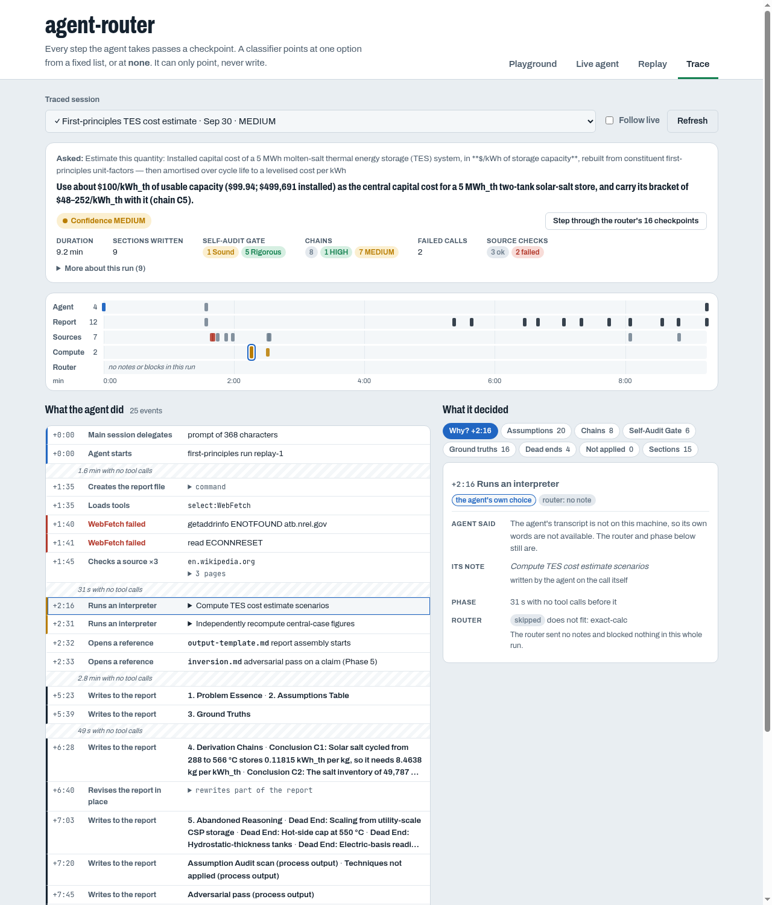

# agent-router × first-principles

A self-contained Claude Code plugin (`agent-router-fp`) that runs next to the
[first-principles](https://github.com/chrisdavidson/first-principles-skill) plugin and leaves
it untouched. It adds two checkpoints that plugin does not have:

1. **Delegation nudge.** When your prompt (or an `Agent` call the main session is about to
   make) looks like a first-principles question, the main session gets a short note: delegate
   it to `first-principles:first-principles`. A prompt that does not fit gets no note.
2. **Exact recompute.** Inside the first-principles agent, when it reaches for `python3 -c`,
   `bc` or similar to compute a figure (Phase 4 estimates, Phase 5 "recompute every computed
   figure"), it gets a note pointing at an exact calculator this plugin serves
   (`mcp__plugin_agent-router-fp_agent_router__calc`: exact fractions and big integers, and a
   list of expressions in one call). The note is offered only when the call is one expression the calculator can run (`fits:
   calc_expression`). A short straight-line python script (variables, `print`, `math.log`,
   `pi`) gets a second entry, `exact-calc-script`, pointing at `calc_script` (`fits:
   calc_script`: a `python3 - <<'EOF'` / `cat <<EOF | python3` heredoc or a multi-statement
   `python3 -c` whose body the calculator's script evaluator runs; no loops, functions, lists
   or imports other than `math`). Anything else is skipped as `does not fit` without reaching
   the classifier. In the 28 example runs, all 16 notes had fired on scripts the calculator
   could not run or on text commands; [`CALC-SCRIPT-COVERAGE.md`](CALC-SCRIPT-COVERAGE.md)
   measures how many of the agent's interpreter calls the two entries could take.

Both are advisory: the model may ignore a note, and nothing is ever blocked.

It also keeps a **decision trace** of each first-principles run: which sections the agent
wrote, which technique references it opened, how it typed and judged each assumption, which
ground truths it could not verify, each chain's confidence, the Self-Audit Gate bands and
whether Fix/Repeat fired, its conclusion, and whether it followed the router's notes. The trace
is record-only: its hooks always answer `{}`. See [Decision trace](#decision-trace).

**Who does what.** agent-router decides *whether* to hand a question to the agent and offers
exact arithmetic. Everything inside the analysis stays with first-principles: Step 0 technique
selection, the slash-only skills, the Self-Audit Gate, the `.first-principles/` output file.
agent-router never points at an individual technique, and never routes the agent's own report
writes (any call naming the `.first-principles` directory is skipped before the classifier).

## Use it

Three ways to load the plugin. The first two load it from a clone of this repo with
`--plugin-dir`; the third installs it from this repo's marketplace.

**From a checkout** (development):

```bash
make install                              # in this repo, once
claude --plugin-dir ~/Projects/first-principles-skill/first-principles \
       --plugin-dir ~/Projects/agent-router/integrations/first-principles/plugin
```

**As a tool** (`uv tool install` puts `agent-router` on your `PATH`):

```bash
uv tool install git+https://github.com/chrisdavidson/agent-router@<branch>
# or, from a local clone, so edits take effect without reinstalling:
uv tool install --editable ~/Projects/agent-router
```

then start Claude Code with the same two `--plugin-dir` flags (the integration's `plugin/`
directory still comes from a clone of this repo).

**From the marketplace.** The repo root has a `.claude-plugin/marketplace.json` listing
`agent-router-fp`:

```bash
claude plugin marketplace add ~/Projects/agent-router    # or chrisdavidson/agent-router
claude plugin install agent-router-fp@agent-router
export AGENT_ROUTER_FP_INTEGRATION=~/Projects/agent-router/integrations/first-principles
```

An installed plugin is a copy of `plugin/` only, in the Claude plugin cache, without
`conduct.py`, `trace.py`, the catalog or the manifest next to it. `AGENT_ROUTER_FP_INTEGRATION`
tells the scripts where the checkout's integration directory is. They read it only when the
directory above `plugin/` lacks `conduct.py`, so a `--plugin-dir` run always uses the code it
sits in. The router is still found from that checkout (its `.venv`, else `PATH`; see below).

The scripts in `plugin/bin/` (`hook`, `trace`, `mcp`, `conduct`, `handoff-hook`) find the
integration directory and the router through `bin/_resolve.sh`,
first match wins:

1. `AGENT_ROUTER_BIN` / `AGENT_ROUTER_PYTHON` (final: if set to something unusable the script
   does not try another);
2. the checkout's `.venv` (`make install`);
3. `agent-router` on `PATH`; `trace` runs the interpreter on that script's shebang line when it
   is an absolute, executable python, else `python3`.

The checkout comes before `PATH` on purpose: the integration directory always sits in a checkout
(the plugin's own, or the one `AGENT_ROUTER_FP_INTEGRATION` names), so a stale `uv tool install`
must not silently outrank the code next to the hooks. If nothing
resolves, `hook` and `trace` print `{}` (fail open) and `mcp` exits non-zero with a message on
stderr.

To read the first-principles manifest, schema and examples from a working tree instead of the
plugin cache, set `FP_PLUGIN_ROOT` to that tree (`~/Projects/first-principles-skill/first-principles`);
Claude Code's Agent tool otherwise runs the installed copy, which can be older.

**When something seems off, run `agent-router doctor --integration first-principles` first.** It
prints one `PASS` / `WARN` / `FAIL` line per check: which router binary won and its version, the
Python version, the descriptor, where the plugin root and manifest came from (and whether that
is the possibly stale cache), the summary schema and its version, the catalog and calibration,
the decider backend and whether the embedding model is available offline, an MCP `initialize` +
`tools/list` round trip with the calculator, the `hooks.json` wiring against the manifest, the
state directory, file locking and the `timeout` binary. It exits 1 only if a check FAILs; add
`--json` for machine-readable output.

| Setting | Default | Meaning |
|---|---|---|
| `AGENT_ROUTER_BACKEND` | `local` | offline classifier; `cascade` asks Jev when unsure (needs a key) |
| `AGENT_ROUTER_THRESHOLD` | calibrated (`calibration.json`) | higher = fewer notes |
| `AGENT_ROUTER_DISABLED` | unset | `1` turns every checkpoint off |
| `AGENT_ROUTER_STATE_DIR` | `$XDG_STATE_HOME/agent-router` | per-session state and audit log |
| `AGENT_ROUTER_SKIP_INPUT` | derived from the manifest: the report directory, escaped, then `(?!\w)` | tool calls matching this are never routed |
| `AGENT_ROUTER_SKIP_PROMPT` | derived: `^\s*(?:<command prefix>\|/<this plugin's name>:)` | prompts matching this get no delegation note: they already launch the agent, or come from this plugin's own commands |
| `AGENT_ROUTER_FP_INTEGRATION` | unset | the checkout's `integrations/first-principles` directory, for a marketplace install only (see [Use it](#use-it)) |
| `FP_PLUGIN_ROOT` | unset | the first-principles plugin tree to read the manifest, schema and examples from (see [`MANIFEST.md`](MANIFEST.md)) |

Hook cost: about 0.45 s per routed call (prompt, `Agent`, and `Bash` inside the agent). A
`Bash` call on the main thread is answered by the shell script in milliseconds, without Python.
Notes are once per turn per entry, so an analysis gets at most one calculator note.

The MCP server (`bin/mcp`) also serves three read-only tools for a conductor, as structured
calls instead of shell commands: `route` (the decision `agent-router route --json` prints, with
this integration's catalog, manifest variables and calibration; advisory, nothing is audited),
`verify_summary(path)` (the report's `contract_status`, violations, the schema used, the
decisions read from the summary block, an excerpt of its `## Answer` section with
`answer_truncated` when it is cut, the paths of the analysis, its reader report and the trace,
and `report_markdown`, the rendered report both ways of starting a run end with; the path must
be inside the working directory) and `doctor` (the checks of `agent-router doctor`). They are
served only because `bin/mcp` exports `AGENT_ROUTER_INTEGRATION`; a bare `agent-router mcp`
serves the catalog tools and `calc_script`. A failure is a tool error, never a crash, and none
of them can block anything.

Every checkpoint is logged to `<state dir>/audit/<session>.jsonl` (same format as the rest of
agent-router, plus `agent_type`, `agent_id` and `tool_use_id`).

## Conductor

`/agent-router-fp:analyze <question>` runs one analysis end to end, so the steps around the agent
are the same every time. The skill (`plugin/skills/analyze/SKILL.md`) sequences them; the
deterministic parts live in `conduct.py` (run through `plugin/bin/conduct`), which the MCP tools
`route` and `verify_summary` share logic with.

1. **Compose**: the delegating prompt follows the agent's Input Contract (the question verbatim
   as the problem statement; domain, key constraints and known ground truths only if you give
   them) plus one line naming the calculator tools when the plugin serves them. It adds no other
   instruction. `compose` also runs the `doctor` checks and the router's preflight on the
   question (each time-bounded) and leaves both, with the prompt's hash, in a hand-off record
   under `<state dir>/conductor/`, so the trace marks that run `launched_by: conductor`. Neither
   check stops the run: what is not clean is shown in the report.
2. **Delegate**: one `Agent` call with the composed prompt, verbatim.
3. **Report**: `conduct report --markdown --handoff <sha256> <analysis>` reads the analysis against the published
   summary contract and renders one report, which the skill shows verbatim: the Answer excerpt
   (marked when it is cut at 1,500 characters), conclusion and confidence, whether the
   Self-Audit Gate cleared, the ground truths not read at source, `contract_status` (with what
   it means when it is not `valid`), any install check or router preflight that was not clean
   ("analysed anyway"), and the paths to the analysis, its reader report and the trace. A
   background run is reported once its completion notification arrives.

It never blocks and never edits: the analysis is only read, a non-valid contract is reported as
it is, and the agent is not re-run. The delegation nudge stays silent for prompts that start with
`/agent-router-fp:`, so the run is not delegated twice.

```bash
claude --plugin-dir ~/Projects/first-principles-skill/first-principles \
       --plugin-dir ~/Projects/agent-router/integrations/first-principles/plugin
# then, in the session:
/agent-router-fp:analyze Is a four-day school week a good idea, or do we just assume five days?
```

### The same run from a plain prompt

You do not need the slash command. Ask the question in plain words and, when the router routes
it to the agent, the hand-off hooks (`plugin/bin/handoff-hook`, steering only, never a deny or a
block) give the run the conductor's shape, so both ways end in the same prompt and the same
report:

- **Same prompt** (`PreToolUse` on the main session's `Agent` call): the prompt is rewritten
  (`updatedInput`) to the one `compose` builds. The question is your prompt verbatim when the
  router routed this turn's prompt, as the skill passes its argument verbatim; otherwise the
  main session's own prompt. A prompt `compose` already wrote is left alone. The hand-off record
  says `launcher: router-hook`, and the trace's `run_end` carries `launched_by`.
- **Same report** (`PostToolUse` on that call): a foreground run is handed the rendered report
  with the instruction to show it verbatim; a background run (the host's default) is handed the
  `conduct report --markdown --since <launch>` command to run when the completion notification
  arrives. Both are the report the skill shows, from the same renderer. A conductor run is left
  to the skill, so it is reported once.

Install problems and out-of-scope questions are handled the same way too: neither route stops.
Both record the `doctor` checks and the router's preflight at compose time and show whatever is
not clean in the report, so a question the router would not have routed reads "analysed anyway"
whichever way it was started. One limit is inherent: if the install is so broken that the hooks
cannot run at all, a plain-prompt run proceeds without them, and its report is then the main
session's own; `doctor` fails the hooks wiring check when either half of the hand-off pair is
missing. A report whose run has no hand-off record says "Run checks: not recorded".

In print mode (`claude -p "/agent-router-fp:analyze ..."`) the host runs the agent in the
background and stops it 10 minutes after the main session's last turn. The conductor waits for
the agent, so a run under 10 minutes is unaffected (the first live run took 6.3), but a longer
analysis is killed half-written. Set `CLAUDE_CODE_PRINT_BG_WAIT_CEILING_MS` (milliseconds, `0` =
no limit) for print-mode runs; `run_examples.py` sets it to its own `--timeout`. Interactive
sessions are not affected.

Other `conduct.py` sub-commands (`plugin/bin/conduct <sub-command>`): `preflight "<q>"`,
`compose "<q>" [--mode focused-<technique>] [--domain D] [--constraint C] [--ground-truth G]`,
`verify <analysis>`, `report [<analysis>] [--since EPOCH] [--markdown]`, `latest-analysis [--cwd DIR]`,
`hook` (the hand-off hooks: hook JSON on stdin), `doctor`, and `record-root <plugin dir>`, which writes
`<state dir>/integration/<plugin>.root` so hooks and the trace on this machine read that tree
instead of the plugin cache (the same effect as `FP_PLUGIN_ROOT`, without the environment).

## Decision trace

`bin/trace` runs on `SubagentStart` / `SubagentStop` for `first-principles:first-principles`,
on `PostToolUse` / `PostToolUseFailure` for `Bash`, `Read`, `ToolSearch`, `WebFetch`, `WebSearch`
and the calculator, and on
the main session's `Agent` call that starts a run. Anything outside
the agent is answered by the shell script in about 5 ms; a traced call takes about 35 ms
(`trace.py` is standard library only), about 1 s over a whole analysis. Each run appends to
`<state dir>/trace/<session>.jsonl`:

| Record | When | What |
|---|---|---|
| `delegation` | the main session calls the agent | the prompt's length and `prompt_names_calc`: whether it already tells the agent to use the calculator |
| `run_start` | the agent starts | `agent_id` |
| `reference_read` | it reads a first-principles reference | the file and what reading it means, e.g. `trade-off.md` = two or more options survived (Phase 4), `pre-mortem.md` / `inversion.md` = Phase 5 on a plan / a claim, `validation-rubric.md` = gate scoring starts |
| `section_written` | a `cat >> .first-principles/analysis-*.md` append | the headings and the `text` appended; `revises` / `restarts` when the same command edits earlier text or empties the file first |
| `report_op` | any other report command | `op`: `create`, `revise` (rewrites part in place) or `check` |
| `calc` / `shell` | a calculator or other Bash call | the expression and result; `interpreter` when a shell call runs python, bc, awk and the like (whether the calculator could run it is the router's fit check, below) |
| `source` | a `WebFetch` or `WebSearch` inside the agent (checking a ground truth) | the host or query; for `WebFetch` the page's HTTP `status` (and `status_text`) and downloaded `bytes`; the reply's length (`chars`) and its first 400 characters (`excerpt`, what the agent was told: WebFetch hands the agent a small model's answer about the page, never the page); and `outcome`: `ok`, `http_error` when the status is 400 or above (blocked or gone), or `reported_missing` when the reply says the page did not have it |
| `tool_loaded` | the agent loads deferred tools (`ToolSearch`) | the query; `calc` when it loads the calculator |
| `tool_failed` | a call fails | tool, what it was, the error (e.g. a source that could not be fetched) |
| `run_end` | the agent stops | duration, final message, report revisions and restarts, the finished report (`analysis_text`, `analysis_sha256`) parsed into `decisions`, `sources` (source checks: ok, reported missing, failed, and the hosts that failed), and `routing` (below). `decisions` come from the report's structured-summary block when `contract.contract_status` is `valid` or `unsupported_version` (`decisions_source: block`; `decisions_verified` is false for the latter), else from prose (`decisions_source: prose`). A run the delivery guard stops more than once writes one `run_end` per stop, each with `stop_attempt` and `stop_hook_active`; `--report`, the demo and anything else read the last one per `agent_id` |

`routing` joins the run to the router's audit log, by `tool_use_id` where the audit has it. It
holds:
- the delegation decision before the run, and `delegation_prompt_names_calc`
- the calculator notes and the call that drew each one (`note_calls`)
- calculator calls before and after the first note, and whether the agent had loaded the
  calculator before it (`calc_loaded_before_first_note`)
- `interpreter_calls` and `interpreter_calls_calc_could_run`, the calls the router's fit check
  passed

A note is credited only with what changed after it. The earlier `calc_note_followed`
(any calculator call after the note) credited notes for use that had already started. In the
rerun, 8 of 10 notes arrived after the agent had loaded the calculator, and 13 of the 28
example prompts had already told the agent to use it.

`decisions` holds:
- the sections
- the run mode, however the report states it, with the line it came from
- every assumption with its type and verdict
- the ground truths, and which are `?` (not read at source)
- each chain with its confidence
- the dead ends
- the techniques not applied, and why
- the gate: the bands of the last scoring pass, `cleared` (worked out from those bands, so it is
  known even when the report has no "Gate result" line), and the result line (the last one, bold
  or not)
- the agent's re-entry disclosure
- the recommended approach with its confidence

A report that was emptied and rewritten keeps only its last gate pass, so `passes_written` also
counts the passes appended during the run. `--report` reports Fix/Repeat as `yes`, `yes
(rewritten)` or `yes (disclosed)`. `contradictions` lists places where the report's own
disclosure disagrees with its gate, for example "no re-entry edge fired" in a report that
re-scored.

On the 28 example reports the parser finds the run mode in all 21 that state one (the old
pattern found 2), the gate result in all 27 that have one, and all 3 Fix/Repeat re-scores.
It flags one contradiction.

```bash
.venv/bin/python integrations/first-principles/trace.py --report ~/.local/state/agent-router/trace
.venv/bin/python integrations/first-principles/trace.py --replay <capture>/run.jsonl --state DIR
```

`--keep-why <trace dir>` copies the agent's own words (its messages and its note on each call)
into traces written before the hooks kept them, while Claude Code still has the transcripts; it
saves each changed trace's original as `<session>.jsonl.bak`. `--report` prints one row per finished run. `--replay` rebuilds the hook payloads from a
`claude -p` stream-json capture, to trace a past run offline.

The trace keeps the report itself, so it still reads after the analysis file is gone.
`analysis_source` says where `decisions` came from:
- `file`: the report on disk.
- `capture`: a replay found the main session's full read of it.
- `handback`: the agent returned the report in its final message instead of writing a file. It
  does this when the delegating prompt asks for markdown back, as one nudge-mode run did.
- `appends`: rebuilt from the `section_written` texts. This is exact only when nothing was revised in
  place (`analysis_exact`).

Replaying the 28 example captures with their reports removed gives decisions for all 28:
22 match the real report exactly, and the other 6 are marked inexact.

**In the demo.** The **Trace** tab shows each run: a summary card, a swimlane chart of the run
over time, a compact log of what the agent did with the router's notes placed where they fired, and
the decisions parsed from its report, one tab per part. With the agent's transcript on the machine,
the log groups calls under what the agent said, and a **Why?** tab explains any selected step: its
stated intent, the router's verdict, what the prompt offered, the outcome and where a result went.



Start it before or during a run, from the checkout:

```bash
make trace                     # the hooks' state root ($AGENT_ROUTER_STATE_DIR, else XDG state)
make trace STATE=integrations/first-principles/runs/structured-summary-live/state   # a saved set
# open http://127.0.0.1:8765/#trace
```

`make trace` is `agent-router demo --catalog integrations/first-principles/catalog.yaml
--state-dir <root>`, which reads `<root>/audit` and `<root>/trace`.

- **Live.** With **Follow live** on (the default), the tab re-reads the trace every 3 seconds while
  it is on screen, and opens a run as soon as it starts. A run you picked by hand keeps the view
  while it is still going. Open sections and the scroll position survive each refresh. Mid-run,
  the card shows elapsed time, sections written, references opened and source checks so far, and
  the decisions column lists the report's headings as they are written. Decisions themselves
  are read when the agent stops.
- **Session labels.** Each session is named by, in order: the hand-off's `description` (the main
  session's few-word name for the task, recorded from this version on); the user's prompt from
  the audit log, without a leading slash command; the report's title. Each label also shows
  whether the session is `● running`, `◌ unfinished` (an open run with nothing new for 10 minutes)
  or `✓` finished, how long ago it was last active, and the conclusion's confidence. Hover a
  label to see the full question.

Not observable from outside the agent, so not traced: the Step 0 mode choice (unless the
report states it), the Phase 1–4 reasoning itself, and techniques applied without opening a
reference (second-order thinking, Phase 2 inversion).

## Files

| File | What |
|---|---|
| `MANIFEST.md`, `manifest.fallback.json`, `descriptor.json` | the integration manifest format, the pinned copy used when the plugin publishes none, and this integration's descriptor |
| `catalog.yaml` | the two entries agent-router may point at (each scoped to one agent context, with its own threshold), plus the `none` exemplars. Targets are `${...}` variables filled from the manifest |
| `eval_set.yaml` | `cal` cases written for this integration; `test` holdout = first-principles' own routing catalog (13 P, 20 N) plus Bash calls inside the agent |
| `calibration.json`, `calibrate.py` | classifier parameters, then one threshold per entry, all fit on the `cal` split only |
| `plugin/` | the Claude Code plugin: hooks, `.mcp.json`, `bin/hook`, `bin/mcp`, `bin/trace`, `bin/handoff-hook`, `bin/conduct`. Listed in the repo's `.claude-plugin/marketplace.json` |
| `handoff/` | the structured-summary hand-off to first-principles and its 9.16 report (the contract the trace reads) |
| `measure_calc_fit.py`, `CALC-SCRIPT-COVERAGE.md` | offline: how many recorded interpreter calls `calc_expression` / `calc_script` accept, and whether the calculator's figures agree with the real output |
| `conduct.py`, `plugin/skills/analyze/` | the conductor: helper sub-commands and the `/agent-router-fp:analyze` skill |
| `trace.py` | the decision trace: hook handler, analysis parser, `--replay`, `--report` |
| `battery.py` | live A/B: first-principles' routing catalog with and without this plugin |
| `run_examples.py` | runs the plugin's worked examples (read from `<plugin root>/<examples_dir>`) through the agent and tabulates every router decision |

## Measuring it

- **Offline:** `agent-router eval --catalog catalog.yaml --cases eval_set.yaml --skip-input
  '\.first-principles\b'` scores the catalog on the `test` holdout with the local
  classifier and `calibration.json`. `calibrate.py` re-fits the calibration on the `cal` split.
- **Live A/B:** `.venv/bin/python integrations/first-principles/battery.py --fp-repo <checkout>` runs
  first-principles' routing catalog with and without this plugin, one fresh `claude -p`
  session per prompt, scored with first-principles' own `detect_routing`. It costs tokens; a
  delegated session is stopped at the delegation.
- **Worked examples:** `.venv/bin/python integrations/first-principles/run_examples.py [--plugin-root PATH]` runs
  the plugin's worked examples (`--fp-repo` is a deprecated alias) through the agent and writes a per-example summary
  and a table of every router decision to a local output folder. Each run gets a status:
  - `complete`
  - `partial`: it ended, but its report lacks a section 1–6 or the gate
  - `failed`: no result, or no report

  The status lists what is missing, so a run cut short by a spend limit or a timeout is not
  counted as done.

  A run whose agent opened the worked example it was redoing (its answer key: the examples are
  listed in the agent's own definition) is marked `†`, and should be left out when comparing
  the agent's decisions with the examples'. On 2026-09-29, 4 of the 28 runs did this.

## Known gaps

- Whether the agent uses the calculator now depends on the main session's delegating prompt.
  Under first-principles 9.13.0 the agent loaded it unprompted in 13 of 15 runs whose prompt
  did not name it. Under 9.14.0 it did so in 0 of 5, and in all 3 runs whose prompt named it.
  The calculator note is not the lever: its fit check found no call in these runs that the
  calculator could run (the agent computes in multi-line scripts), so it stays silent. The
  trace records the prompt (`delegation_prompt_names_calc`) and the load (`calc_loaded_at`).

- A quantitative decision phrased as "From first principles: is it cheaper to…" scored
  `none` for the delegation nudge (the examples are qualitative), and first-principles' own
  description did not route it either. Launch such questions with
  `/first-principles:first-principles-analysis`.
